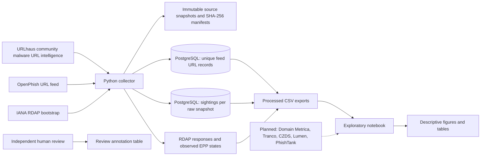

# Data flow and research safeguards

## Provenance and time semantics

Each feed response is captured verbatim with a UTC-named filename and adjacent manifest containing the source, retrieval timestamp, byte length, and SHA-256 digest. URLhaus record dates are source-event timestamps. OpenPhish's plain-text feed supplies no per-URL event timestamp; these rows retain null event time and a separate observation/collection time. RDAP results include the selected endpoint and retrieval time.

`abuse_flags` represents a stable `(source_feed, exact URL)` record. `feed_observations` records an occurrence per feed snapshot, preventing reruns from multiplying the same sighting. Source record IDs are preserved when supplied. Raw snapshots remain the provenance record.

## Interpretation boundaries

Threat feeds identify reported URLs; they do not establish who registered a domain, whether the whole domain is compromised, or what action a registrar took. URLhaus is community-sourced malware-distribution intelligence, not a registrar-action or rights-impact dataset. Registrant category values are lexical/TLD candidates only. Candidate classes are versioned heuristic outputs with exported cues; they are not verified labels or probabilities.

RDAP EPP values describe observed registration data. They are distinct from `epp_status_applied`, which stays null absent verified case evidence. The collector does not suspend domains, send notices, grant cure periods, score actual collateral harm, or decide due-process compliance. Legacy fields that represented assumed actions are cleared during migration rather than treated as observed facts.

## Current scope and evidence gaps

This prototype contains URLhaus and OpenPhish feed snapshots plus point-in-time RDAP lookups. It does not contain registrar decisions, compliance cases, notices, appeals, service-impact observations, or verified non-commercial registrant labels. Domain Metrica (the successor to DAAR), Contractual Compliance reports, Lumen, PhishTank, CZDS, historical NS/MX, Tranco, and verified nonprofit-registry data are not currently collected here. Treat them as proposed inputs unless acquired, documented, and joined. Candidate labels and descriptive feed counts cannot establish false-positive rates, registrar conduct, collateral damage, or legal conclusions.

## Descriptive results and figures

The exploratory notebook (`notebooks/exploratory_analysis.ipynb`) reports feed counts, the classification cross-tab, and the inline matplotlib plots. The first snapshot (n = 26) shows that most flagged URLs are cloud-platform subdomains (17 of 26) rather than registered second-level domains (9 of 26), and that no RDAP creation date (0 of 26) or independent review (0 of 26) was available. This is an observed absence in the current instrumentation, not a statement about the world; it motivates the planned data above rather than resolving the measurement gap.

