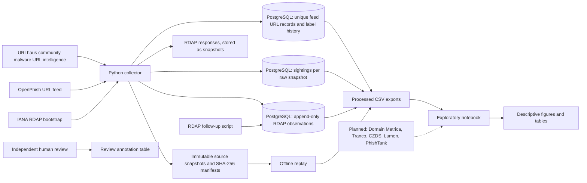

# Data flow and research safeguards

## Provenance and time semantics

Each feed response is captured verbatim with a UTC-named filename and adjacent manifest containing the source, retrieval timestamp, byte length, and SHA-256 digest. The manifest time is the moment the response arrived, not a file-system timestamp. Every row of a snapshot shares that time as its `observed_at`. URLhaus record dates are source-event timestamps. OpenPhish's plain-text feed supplies no per-URL event timestamp; these rows retain null event time and a separate observation/collection time.

Each successful RDAP response is stored the same way under `data/raw/rdap/`. Responses from before version 0.3.0 survive only as JSONB in the database; `scripts/backfill_rdap_snapshots.py` copies them out, and their manifests say that they are re-serialised rather than the original bytes.

`abuse_flags` represents a stable `(source_feed, exact URL)` record. `raw_snapshot` and `observed_at` stay at the first sighting, and `last_raw_snapshot` and `last_observed_at` move forward with each run. `feed_observations` records an occurrence per feed snapshot, preventing reruns from multiplying the same sighting. Source record IDs are preserved when supplied. Raw snapshots remain the provenance record.

Two tables are append-only. `rdap_observations` keeps one row per RDAP lookup, including failures with their HTTP status or error, so statuses can be compared over time. `classification_history` keeps each label a URL received, with its rule version and snapshot. A database trigger rejects updates to both, and deletes from `rdap_observations`. The latest values in `monitored_domains` and `abuse_flags` are conveniences. A failed lookup leaves the last observed statuses and registration date in place.

## Names and RDAP routing

The lexical rules read a name from the Public Suffix List including its private section, so `tenant.vercel.app` is what they see. RDAP is queried for the name a registrar sponsors, from the ICANN section of the list (`vercel.app`), at the endpoint the IANA bootstrap gives for its last label. The third-party `rdap.org` service is the fallback for a TLD outside the bootstrap, and `rdap_observations.via_iana_bootstrap` records which was used. Each domain is queried once per run, and requests to one RDAP host are spaced at least a second apart.

A tenant host's row carries `is_platform_tenant = true` and none of the platform's registration data, because the platform's registration date says nothing about the tenant. The suffix list comes from the pinned `tldextract`, so parsing is reproducible. `CURATED_PLATFORM_DOMAINS` in `pipeline.py` adds platforms missing from that bundled list, and `platform_tenant_basis` records which source applied.

## Domain age

`domain_age_at_flag_days` is measured from a feed's event time and stays null when a feed supplies none. `domain_age_at_observation_days` is measured from collection time, at the first run with a registration date. For OpenPhish rows it is an upper bound, because the URL was listed at some unknown time before collection. A negative age means the current registration is newer than the reference time, for example a re-registered name. It is reported as measured, and the rules treat it as unknown.

The rule set `heuristics-2026-01`, which produced the 24 October 2026 sample, reads age only from a feed event time. `heuristics-2026-02` applies the same rules and cues but falls back to collection time, so an OpenPhish row with a registration date can now reach the age-based branches.

## Interpretation boundaries

Threat feeds identify reported URLs; they do not establish who registered a domain, whether the whole domain is compromised, or what action a registrar took. URLhaus is community-sourced malware-distribution intelligence, not a registrar-action or rights-impact dataset. Registrant category values are lexical/TLD candidates only. Candidate classes are versioned heuristic outputs with exported cues; they are not verified labels or probabilities. Cues are recorded whether or not a rule used them, and the rule that fired is not stored.

RDAP EPP values describe observed registration data. They are distinct from `epp_status_applied`, which stays null absent verified case evidence. The collector does not suspend domains, send notices, grant cure periods, score actual collateral harm, or decide due-process compliance. A hold seen in RDAP shows that a hold exists, not who asked for it or whether it was justified.

## Current scope and evidence gaps

This prototype contains URLhaus and OpenPhish feed snapshots plus RDAP lookups. It does not contain registrar decisions, compliance cases, notices, appeals, service-impact observations, or verified non-commercial registrant labels. Domain Metrica (the successor to DAAR), Contractual Compliance reports, Lumen, PhishTank, CZDS, historical NS/MX, Tranco, and verified nonprofit-registry data are not currently collected here. Treat them as proposed inputs unless acquired, documented, and joined. Candidate labels and descriptive feed counts cannot establish false-positive rates, registrar conduct, collateral damage, or legal conclusions.

## Descriptive results and figures

The exploratory notebook (`notebooks/exploratory_analysis.ipynb`) reports feed counts, the classification cross-tab, RDAP outcomes, domain ages and the inline matplotlib plots. Its stored outputs come from the replay of the first snapshot described in the README.

That snapshot (n = 26) is a convenience sample: the first 25 rows of each feed, before IP-hosted URLs were removed. Most flagged URLs are cloud-platform subdomains (17 of 26) rather than registered second-level domains (9 of 26). RDAP returned a registration date for all five domains that answered, between 2 days and about 19 years old at collection. The other 21 rows had none: 16 queried a tenant name that no registry holds, and 5 fell under ccTLDs outside the bootstrap. Version 0.2.0 exported no registration dates and computed age only from a feed event time, so its CSV shows no age for any row. None of the rows has been independently reviewed (0 of 26).
